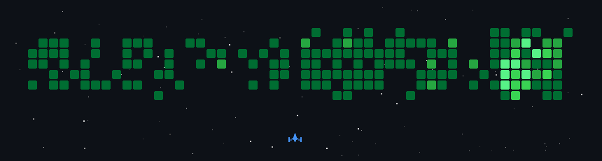

  <a href="README.md">🇧🇷 Português</a> · <b>🇺🇸 English</b>

  

  
  
  
  

---

## 👨‍💻 About me

<table>
  <tr>
    <td width="52%" valign="top">

- 🔭 Systems Analyst at **Hospital Especial Domiciliar**, working with Protheus/ADVPL and **TISS** healthcare billing
- 🚀 Full Stack Developer at **Teia Software**, building multi-tenant SaaS for **healthcare** and **finance**
- 🌱 Currently exploring **applied AI** (Gemini, Spring AI, pgvector) and **mobile** (React Native, Kotlin)
- 💬 Ask me about **Next.js, Spring Boot, Angular and Protheus**
- 🎓 Degree in Computer Networks
- ⚡ Off the clock: games, anime, football and financial markets

</td>
    <td width="48%" valign="top" align="center">
      
    </td>
  </tr>
</table>

## 🧰 Tech Stack

<table align="center">
  <tr>
    <td align="center" width="140"><b>Front-end</b></td>
    <td></td>
  </tr>
  <tr>
    <td align="center"><b>Back-end</b></td>
    <td></td>
  </tr>
  <tr>
    <td align="center"><b>ERP</b></td>
    <td></td>
  </tr>
  <tr>
    <td align="center"><b>Mobile</b></td>
    <td></td>
  </tr>
  <tr>
    <td align="center"><b>Data</b></td>
    <td></td>
  </tr>
  <tr>
    <td align="center"><b>DevOps & Testing</b></td>
    <td></td>
  </tr>
</table>

## 🚀 Featured projects

<table>
  <tr>
    <td width="50%" valign="top">
      <h3>🏥 Teia BPM</h3>
      Hospital workflow platform with a multi-tenant mobile app, real-time notifications and AI.  
      <code>Next.js</code> <code>Fastify</code> <code>React Native</code> <code>Redis</code> <code>RabbitMQ</code> <code>Gemini</code>
    </td>
    <td width="50%" valign="top">
      <h3>💳 Nexflow</h3>
      Financial platform for a construction company: card and PIX reconciliation, CNAB and bank slips, POS app, legal collections workflow and TOTVS RM integration.  
      <code>Next.js 14</code> <code>Prisma</code> <code>PostgreSQL</code> <code>Kotlin</code> <code>CNAB</code>
    </td>
  </tr>
  <tr>
    <td width="50%" valign="top">
      <h3>⚖️ TeiaRJ</h3>
      Multi-tenant platform for judicial recovery (bankruptcy restructuring) cases, with digital document signing.  
      <code>Spring Boot</code> <code>Multi-tenant</code> <code>ClickSign</code>
    </td>
    <td width="50%" valign="top">
      <h3>📅 Shift & Staff Scheduling</h3>
      Scheduling rules engine, smart staff matching by geolocation, and billing.  
      <code>Spring Boot 3</code> <code>Angular 18</code> <code>PostgreSQL</code> <code>Spring AI</code> <code>pgvector</code>
    </td>
  </tr>
  <tr>
    <td width="50%" valign="top">
      <h3>🩺 Protheus HED</h3>
      Hospital management, prescriptions and TISS billing, with REST APIs for the mobile app.  
      <code>ADVPL</code> <code>TOTVS Protheus 12</code> <code>SQL Server</code> <code>REST</code>
    </td>
    <td width="50%" valign="top">
      <h3>💬 CRM WhatsApp</h3>
      Chatbot CRM with zero-downtime blue-green deploys.  
      <code>Next.js 16</code> <code>Prisma</code> <code>Docker</code> <code>GitHub Actions</code>
    </td>
  </tr>
</table>

<b>➕ More projects</b>

 

| Project | What it is | Stack |
|---|---|---|
| 🎧 **Teia Desk** | Multi-company helpdesk with ticket creation via email | `Next.js` `Drizzle` `PostgreSQL` `S3` |
| 🧠 [Memoteca](https://github.com/GabrielPyrrho/Memoteca-Angular) | App to record and organize memories | `Angular` `TypeScript` |

> 🔒 Most professional projects are private. Happy to walk through them in a conversation.

<b>🎮 Bonus: my contribution graph as a game</b>

 

  

