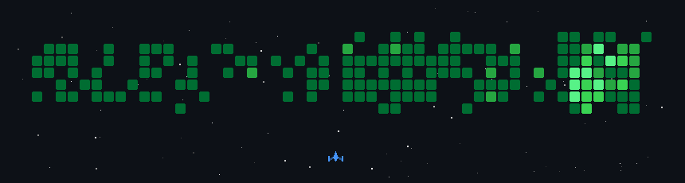

  <b>🇧🇷 Português</b> · <a href="README.en.md">🇺🇸 English</a>

  

  
  
  
  

---

## 👨‍💻 Sobre mim

<table>
  <tr>
    <td width="52%" valign="top">

Desenvolvedor Full Stack focado em sistemas para **saúde** e **finanças**. Trabalho de ponta a ponta: do ERP **TOTVS Protheus (ADVPL)** a aplicações web em **Next.js e Angular**, APIs em **Spring Boot e Node** e apps mobile.

- 🏥 **Hospital Especial Domiciliar**, Analista de Sistemas: customizações Protheus, faturamento TISS e APIs REST para o app
- 🚀 **Teia Software**, Full Stack (PJ): SaaS multi-tenant para saúde, construção civil e área jurídica (Teia BPM, Nexflow, TeiaRJ)
- 🧠 **Foco atual:** IA aplicada a produtos (Gemini, Spring AI, pgvector) e arquitetura multi-tenant
- 🎓 **Formação** em Redes de Computadores, com base forte em infraestrutura e Linux

</td>
    <td width="48%" valign="top" align="center">
      
    </td>
  </tr>
</table>

## 🧰 Tech Stack

<table align="center">
  <tr>
    <td align="center" width="140"><b>Front-end</b></td>
    <td></td>
  </tr>
  <tr>
    <td align="center"><b>Back-end</b></td>
    <td></td>
  </tr>
  <tr>
    <td align="center"><b>ERP</b></td>
    <td></td>
  </tr>
  <tr>
    <td align="center"><b>Mobile</b></td>
    <td></td>
  </tr>
  <tr>
    <td align="center"><b>Dados</b></td>
    <td></td>
  </tr>
  <tr>
    <td align="center"><b>DevOps & Testes</b></td>
    <td></td>
  </tr>
</table>

## 🚀 Projetos em destaque

<table>
  <tr>
    <td width="50%" valign="top">
      <h3>🏥 Teia BPM</h3>
      Workflow hospitalar com app mobile multi-tenant, notificações em tempo real e IA.  
      <code>Next.js</code> <code>Fastify</code> <code>React Native</code> <code>Redis</code> <code>RabbitMQ</code> <code>Gemini</code>
    </td>
    <td width="50%" valign="top">
      <h3>💳 Nexflow</h3>
      Plataforma financeira para construtora: conciliação de cartão e PIX, CNAB e boletos, app POS, régua jurídica e integração com TOTVS RM.  
      <code>Next.js 14</code> <code>Prisma</code> <code>PostgreSQL</code> <code>Kotlin</code> <code>CNAB</code>
    </td>
  </tr>
  <tr>
    <td width="50%" valign="top">
      <h3>⚖️ TeiaRJ</h3>
      Plataforma multi-tenant para processos de recuperação judicial, com assinatura digital de documentos.  
      <code>Spring Boot</code> <code>Multi-tenant</code> <code>ClickSign</code>
    </td>
    <td width="50%" valign="top">
      <h3>📅 Gestão de Escalas e Plantões</h3>
      Motor de regras de escala, seleção inteligente de profissionais por geolocalização e faturamento.  
      <code>Spring Boot 3</code> <code>Angular 18</code> <code>PostgreSQL</code> <code>Spring AI</code> <code>pgvector</code>
    </td>
  </tr>
  <tr>
    <td width="50%" valign="top">
      <h3>🩺 Protheus HED</h3>
      Gestão hospitalar, prescrições e faturamento TISS, com APIs REST para o app.  
      <code>ADVPL</code> <code>TOTVS Protheus 12</code> <code>SQL Server</code> <code>REST</code>
    </td>
    <td width="50%" valign="top">
      <h3>💬 CRM WhatsApp</h3>
      CRM de chatbots com deploy blue-green sem downtime.  
      <code>Next.js 16</code> <code>Prisma</code> <code>Docker</code> <code>GitHub Actions</code>
    </td>
  </tr>
</table>

<b>➕ Ver mais projetos</b>

 

| Projeto | O que é | Stack |
|---|---|---|
| 🎧 **Teia Desk** | Helpdesk multi-empresa com abertura de chamados por e-mail | `Next.js` `Drizzle` `PostgreSQL` `S3` |
| 🧠 [Memoteca](https://github.com/GabrielPyrrho/Memoteca-Angular) | App para registrar e organizar memórias | `Angular` `TypeScript` |

> 🔒 A maioria dos projetos profissionais é privada. Posso mostrar detalhes em uma conversa.

<b>🎮 Bônus: meu gráfico de contribuições virou um jogo</b>

 

  

